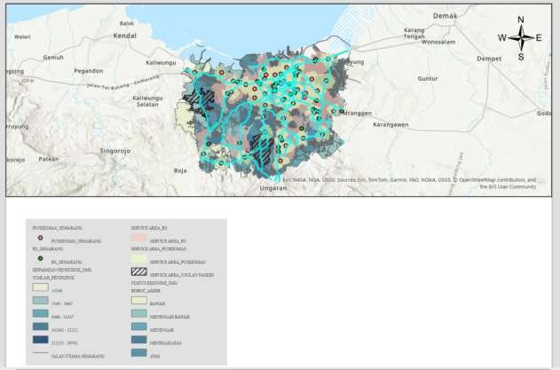
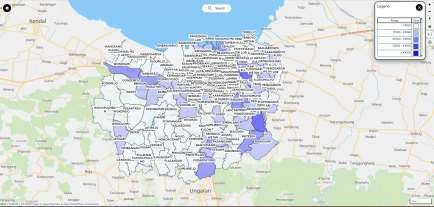

# Analisis Kesenjangan Layanan Kesehatan Kota Semarang (ArcGIS Pro & MAPID)

Analisis deskriptif dan prediktif sebaran rumah sakit dan puskesmas di Kota Semarang, dikerjakan dengan dua platform: ArcGIS Pro dan MAPID.

Tugas 2 bootcamp WebGIS Developer (Location Analytics 1).

| ArcGIS Pro | MAPID |
|---|---|
|  |  |

## Pertanyaan

1. Bagaimana sebaran fasilitas kesehatan per kecamatan?
2. Wilayah mana yang belum terjangkau, dan di mana potensi lokasi fasilitas baru?

## Temuan utama

- Rumah sakit dan puskesmas terkonsentrasi di pusat kota, di kecamatan dengan aktivitas ekonomi tinggi dan akses jalan yang baik.
- Pinggiran barat dan selatan memiliki kepadatan fasilitas rendah dengan jarak antar fasilitas yang jauh.
- Tanpa fasilitas baru, wilayah selatan dan pinggiran berisiko makin tertinggal seiring pertumbuhan penduduk.
- Rekomendasi: prioritaskan kecamatan dengan kepadatan fasilitas rendah dan kepadatan penduduk tinggi.

## Metode

- **ArcGIS Pro:** penyamaan CRS (WGS 1984 Web Mercator), filter data sosial-ekonomi berdasarkan jumlah penduduk, heatmap fasilitas, dan area layanan.
- **MAPID:** sebaran penduduk per kelurahan, isochrone 10 menit dari pusat kota, dan analisis radius 2 km (pusat kota) dan 5 km (titik terjauh dari rumah sakit).

## Isi repo

| File | Isi |
|---|---|
| `Task 1 & 2_ GIS Fundamental.aprx` | Proyek ArcGIS Pro |
| `TASK 2 _ Locataion Analytics_Acrgis Version.pdf` | Laporan versi ArcGIS Pro |
| `TASK 2 _ Locataion Analytics_MAPID.pdf` | Laporan versi MAPID |

## Tools

ArcGIS Pro · MAPID · OpenStreetMap

## Penulis

**Arsya Dika** · [GitHub](https://github.com/ArsyaDika)
