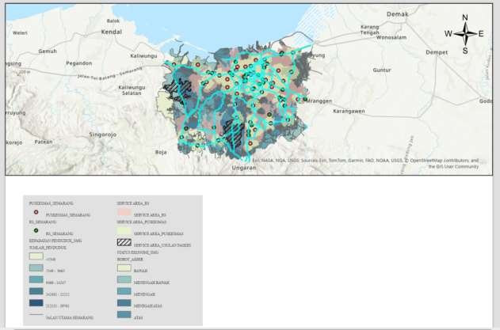
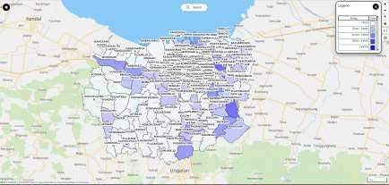

# Healthcare Service Gap Analysis, Semarang City (ArcGIS Pro & MAPID)

Health facilities cluster in the center of Semarang, while the western and southern edges are thinly served. Working in both ArcGIS Pro and MAPID, this project makes that gap visible and **recommends prioritizing districts with low facility density and high population density**.

Task 2 of the WebGIS Developer bootcamp (Location Analytics 1).

| ArcGIS Pro | MAPID |
|---|---|
|  |  |

## Questions

1. How are health facilities distributed across districts?
2. Which areas are not reached, and where are the potential sites for new facilities?

## Key findings

- Hospitals and puskesmas are concentrated in the city center, in districts with high economic activity and good road access.
- The western and southern edges have low facility density, with long distances between facilities.
- Without new facilities, the south and the outskirts risk falling further behind as the population grows.
- Recommendation: prioritize districts with low facility density and high population density.

## Method

- **ArcGIS Pro:** CRS alignment (WGS 1984 Web Mercator), filtering of socio-economic data by population, a facility heatmap, and service areas.
- **MAPID:** population distribution by village (kelurahan), a 10-minute isochrone from the city center, and radius analysis at 2 km (city center) and 5 km (the point farthest from a hospital).

## Repository contents

| File | Contents |
|---|---|
| `Task 1 & 2_ GIS Fundamental.aprx` | ArcGIS Pro project |
| `TASK 2 _ Locataion Analytics_Acrgis Version.pdf` | ArcGIS Pro report (Indonesian) |
| `TASK 2 _ Locataion Analytics_MAPID.pdf` | MAPID report (Indonesian) |

## Tools

ArcGIS Pro · MAPID · OpenStreetMap

## Author

**Arsya Dika** · [GitHub](https://github.com/ArsyaDika)

------------------

# Analisis Kesenjangan Layanan Kesehatan Kota Semarang (ArcGIS Pro & MAPID)

Analisis deskriptif dan prediktif sebaran rumah sakit dan puskesmas di Kota Semarang, dikerjakan dengan dua platform: ArcGIS Pro dan MAPID.

Tugas 2 bootcamp WebGIS Developer (Location Analytics 1).

| ArcGIS Pro | MAPID |
|---|---|
|  |  |

## Pertanyaan

1. Bagaimana sebaran fasilitas kesehatan per kecamatan?
2. Wilayah mana yang belum terjangkau, dan di mana potensi lokasi fasilitas baru?

## Temuan utama

- Rumah sakit dan puskesmas terkonsentrasi di pusat kota, di kecamatan dengan aktivitas ekonomi tinggi dan akses jalan yang baik.
- Pinggiran barat dan selatan memiliki kepadatan fasilitas rendah dengan jarak antar fasilitas yang jauh.
- Tanpa fasilitas baru, wilayah selatan dan pinggiran berisiko makin tertinggal seiring pertumbuhan penduduk.
- Rekomendasi: prioritaskan kecamatan dengan kepadatan fasilitas rendah dan kepadatan penduduk tinggi.

## Metode

- **ArcGIS Pro:** penyamaan CRS (WGS 1984 Web Mercator), filter data sosial-ekonomi berdasarkan jumlah penduduk, heatmap fasilitas, dan area layanan.
- **MAPID:** sebaran penduduk per kelurahan, isochrone 10 menit dari pusat kota, dan analisis radius 2 km (pusat kota) dan 5 km (titik terjauh dari rumah sakit).

## Isi repo

| File | Isi |
|---|---|
| `Task 1 & 2_ GIS Fundamental.aprx` | Proyek ArcGIS Pro |
| `TASK 2 _ Locataion Analytics_Acrgis Version.pdf` | Laporan versi ArcGIS Pro |
| `TASK 2 _ Locataion Analytics_MAPID.pdf` | Laporan versi MAPID |

## Tools

ArcGIS Pro · MAPID · OpenStreetMap

## Penulis

**Arsya Dika** · [GitHub](https://github.com/ArsyaDika)
